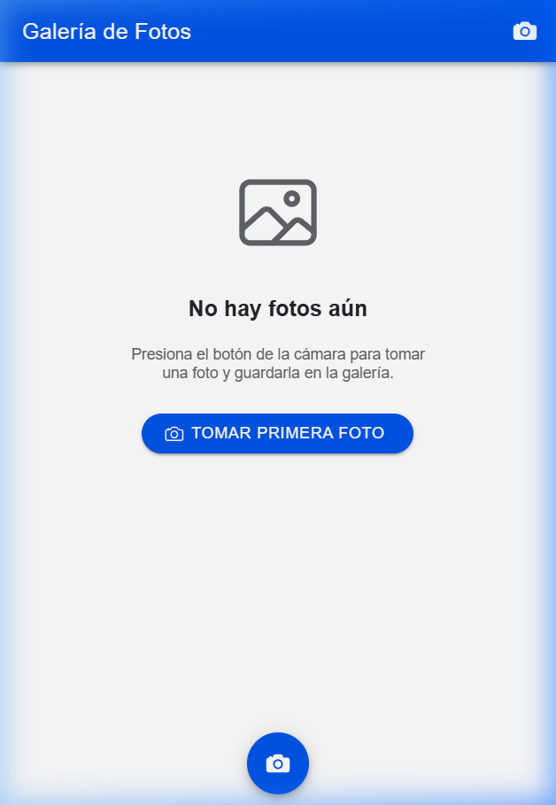
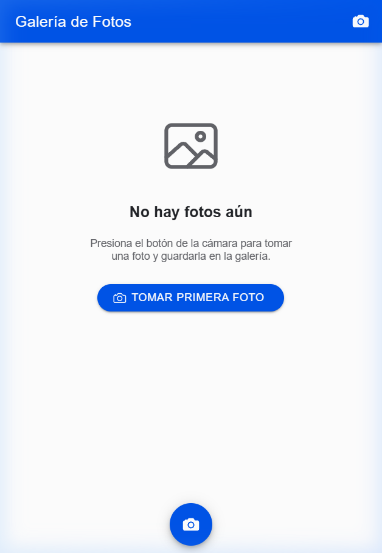
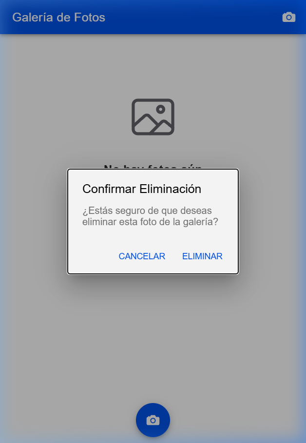

# Aplicación de Galería de Fotos - Ionic & Capacitor

## 📋 Descripción del Proyecto

Aplicación móvil desarrollada con **Ionic Framework**, **Angular** y **Capacitor** que permite a los usuarios gestionar sus fotografías de manera sencilla e intuitiva:

1. **Tomar fotos**: Captura imágenes directamente con la cámara del dispositivo móvil (o mediante la cámara web/selector en entorno de desarrollo).
2. **Guardar fotos**: Almacena las imágenes localmente de forma persistente y las guarda en la **galería del teléfono** (`saveToGallery: true`).
3. **Eliminar fotos**: Permite borrar fotografías de la galería y del almacenamiento con una alerta de confirmación previa.
4. **Visualización**: Presenta las fotos guardadas en una cuadrícula interactiva y ordenada.

---

## 🛠️ Tecnologías Utilizadas

- **Ionic 8 / Angular 19+**: Componentes de UI modernos (Standalone Components, `ion-fab`, `ion-grid`, `ion-card`, `ion-alert`).
- **Capacitor 8**:
  - `@capacitor/camera`: Manejo de la cámara y guardado en la galería nativa.
  - `@capacitor/filesystem`: Almacenamiento y eliminación física de archivos en el dispositivo.
  - `@capacitor/preferences`: Persistencia de metadatos de las fotografías guardadas.
- **@ionic/pwa-elements**: Soporte de cámara para pruebas en navegadores web.
- **TypeScript & SCSS**: Lógica y estilos adaptados a estándares móviles.

---

## 📱 Capturas de Pantalla

### 1. Pantalla Inicial (Sin Fotos)
Vista limpia cuando no existen fotografías almacenadas, invitando al usuario a realizar su primera captura.



### 2. Galería de Fotos
Cuadrícula responsiva que muestra las fotos tomadas, el contador de fotos guardadas y las opciones para cada imagen.



### 3. Confirmación de Eliminación
Diálogo modal de confirmación antes de eliminar permanentemente cualquier fotografía del almacenamiento.



---

## 📂 Estructura Principal del Proyecto

```text
src/
├── app/
│   ├── home/
│   │   ├── home.page.html       # Vista con la cuadrícula de fotos, FAB y empty state
│   │   ├── home.page.scss       # Estilos visuales de las tarjetas y el layout
│   │   └── home.page.ts         # Controlador de eventos (tomar foto, confirmación de borrado)
│   ├── services/
│   │   └── photo.service.ts     # Lógica con Capacitor Camera, Filesystem y Preferences
│   ├── app.component.ts         # Componente raíz
│   └── app.routes.ts            # Enrutamiento de la aplicación
├── main.ts                      # Punto de entrada con inicialización de PWA Elements
capacitor.config.ts              # Configuración de Capacitor para plataformas móviles
```

---

## ⚙️ Métodos Principales (`photo.service.ts`)

- **`addNewToGallery()`**:
  Abre la cámara del dispositivo usando `Camera.getPhoto()`, activa la opción `saveToGallery: true` para guardarla en la galería nativa, guarda el archivo en el sistema de archivos interno con `Filesystem.writeFile()` y actualiza la lista en `Preferences`.

- **`loadSaved()`**:
  Carga la lista de fotos guardadas desde `Preferences` al iniciar la aplicación.

- **`deletePicture(photo, position)`**:
  Elimina la foto seleccionada del arreglo en memoria, actualiza `Preferences` y borra el archivo físico correspondiente mediante `Filesystem.deleteFile()`.

---

## 🚀 Instrucciones de Instalación y Ejecución

### Prerrequisitos
- [Node.js](https://nodejs.org/) (versión 18 o superior)
- Ionic CLI instalado globalmente:
  ```bash
  npm install -g @ionic/cli
  ```

### 1. Clonar el repositorio
```bash
git clone https://github.com/alexbarba2753/CamaraFotosIonic.git
cd CamaraFotosIonic
```

### 2. Instalar dependencias
```bash
npm install
```

### 3. Ejecutar en el navegador
```bash
ionic serve
# o
npm start
```

### 4. Compilar y ejecutar en Android
```bash
# Compilar los archivos web
npm run build

# Sincronizar con el proyecto Android
npx cap sync android

# Abrir el proyecto en Android Studio
npx cap open android
```

---

## 👨‍💻 Autor

- **Nombre**: Alex Barba
- **Repositorio**: [https://github.com/alexbarba2753/CamaraFotosIonic](https://github.com/alexbarba2753/CamaraFotosIonic)
